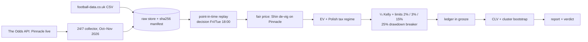

# valuebet — a pre-registered value-betting research system (Poland)

> **Research project.** The system computes fair prices and sends alerts — it **never places bets**. Not betting advice.

**Question.** Can a disciplined, strictly legal value-betting system make money at Polish licensed bookmakers?

**Answer.** The edge is real but thin. Across 2,628 bets the system bought prices **1.97% better than the Pinnacle closing line** (95% CI +1.52% to +2.42%). Under Poland's 12% tax on every stake the same bets lose money; only tax-free promotions leave an estimated **~1–3% of capital per year**. The project deliberately stopped at the backtest stage — that is what the backtest was for.

## Key results — official run `4599dca`, independently audited

Data: football-data.co.uk · 22 European leagues · 7 seasons (2019/20–2025/26) · 51,653 matches · 38 strategy runs.
Primary metric: **CLV** (closing line value) with cluster-bootstrap 95% CI (clusters = ISO weeks).

| Strategy | What it is | Bets | CLV (95% CI) |
|---|---|---|---|
| **A** | best price of 2 bookmakers (Bet365, Bwin), tax-free | 2,628 | **+1.97%** (+1.52, +2.42) |
| A — robustness | same bets, power-method margin removal | 2,628 | +1.52% (+1.05, +1.98) |
| **A3** | best price of 3 bookmakers (+ William Hill) | 3,146 | **+2.65%** (+2.19, +3.12) |
| B365 | single bookmaker | 2,461 | +1.54% (+1.04, +2.02) |
| **D** | A settled under the 12% stake tax (control) | 2,628 | **−10.27%** (yield −13.95%) |

**The tax arithmetic is exact:** 0.88 × (1 + 0.0197) − 1 = −10.27% — the measured CLV of D.

CLV of strategy A by season:

| Season | 19/20 | 20/21 | 21/22 | 22/23 | 23/24 | 24/25 | 25/26* |
|---|---|---|---|---|---|---|---|
| Bets | 622 | 451 | 527 | 377 | 355 | 186 | 110 |
| CLV | +2.60% | +2.90% | +1.36% | +2.59% | +1.07% | +0.97% | +0.02% |

\* Pinnacle odds disappear from football-data from November 2025 (38% coverage in 2025/26).

### Why CLV and not profit

- Profit is noise at this sample size: yield of A is +7.24% with a 95% CI of **+0.92% to +13.61%** (12.7 pp wide). CLV's CI is 0.9 pp wide.
- The 10 biggest wins produced 56% of A's profit; without them the yield is +3.2%.
- The raw backtest showed **+14%/yr (A) and +27%/yr (A3)** compounded returns. Those numbers are mostly luck plus compounding and are **not** reported as results (see the audit, `reports/audit/FSA_2026-11-13_F1.md`).

### Laboratory vs Poland (estimate)

| | Laboratory | Poland |
|---|---|---|
| Bookmakers | best of 3, no Polish licence | 1 tax-free venue |
| Tax | none | 12% of every stake (tax-free only via promotions) |
| Expected return | ~11% of capital/yr (A3; ~7.6% on leagues available live) | **~1–3% of capital/yr** |

Estimate = Σ(stake / bankroll at bet time × CLV) per year at ¼ Kelly; Polish figure assumes a 1–2% worse price (measured Betclic margin 7.3% vs ~4% best-of-3). In-sample, before account limits.

## What makes it rigorous

- **Pre-registration.** Strategies, metrics, alarms and verdict criteria were frozen in `BACKTEST_FIN_PLAN.md` before any result. No tuning after results.
- **Point-in-time replay.** Every decision sees only data available at the decision moment (Fri/Tue 18:00 London, matching when the source collects odds). Closing odds are used only to measure CLV.
- **Engine gate (25 tests).** Known-answer, placebo and tax tests, plus "poison" tests: permuting match results or closing odds must not change a single decision.
- **Adversarial audits.** Seven audit rounds. Earlier rounds caught two critical bugs that had passed all unit tests (e.g. a tax window that looked into the future, worth 6 pp of stake). The final audit (FSA #1) found **0 critical and 0 major issues** and independently recomputed A, C and D to the grosz.
- **Reproducibility.** Every run is labelled with its commit hash; raw data is immutable and checked against a sha256 manifest.
- 1,083 automated tests (pytest), none of which needs local data files, `ruff`, `mypy --strict` on `src/`.

## Architecture



## Repository map

| Path | What it is |
|---|---|
| `src/valuebet/net/http.py` | The only network client: ≥ 10 s per host, `robots.txt`, throttle state shared between processes. |
| `src/valuebet/ingest/` | `raw_store.py` (the only writer to `data/raw`, sha256 manifest), football-data loaders, The Odds API client with a credit budget, the 24/7 odds collector, team-name aliases. |
| `src/valuebet/pricing/` | `shin.py` (Shin margin removal), `fair.py` (Pinnacle fair price at decision time), `ev.py` (EV and the Polish tax regimes), `kelly.py` (¼ Kelly, stake limits, drawdown breaker). |
| `src/valuebet/backtest/` | `replay.py` (point-in-time decision snapshots), `financial.py` (event loop on the live modules), `strategies.py` / `strategy_c.py` (strategy table, tax-free promotion regime), `clv.py`, `metrics.py` (log loss, reliability, bootstrap); earlier model baselines (Elo, Dixon–Coles, lockbox). |
| `src/valuebet/live/` | `bets.py` (append-only coupon ledger); `digest.py` (daily digest, not wired). |
| `src/valuebet/features/`, `models/` | Point-in-time feature mechanics, Elo and Dixon–Coles models from the closed model track. |
| `src/valuebet/schema.py`, `config.py`, `provenance.py` | Canonical data models, strategy/live config loading, commit labels for reports. |
| `config/` | `strategy.yaml`, `live.yaml`, `bookmakers.yaml` (promotion terms). |
| `scripts/` | Entry points: `ingest_football_data.py`, `verify_raw.py`, `engine_tests.py` (engine gate), `run_backtest_fin.py` (official run), `reconcile_bets.py` (independent double-entry check), `collect_odds.py`, `odds_budget.py`. |
| `tests/` | Unit, regression (one per audit finding) and rule-enforcement tests (`test_rule29_wiring.py`, `test_rule30_guards.py`). |
| `reports/audit/` | Full-system audit reports (FSA) and fix logs with before/after test results. |
| `reports/backtest_fin/` | Engine-gate reports per commit. |
| `reports/evidence/` | Evidence used by the final audit: alarm diagnosis, audit scripts, official run report. |
| `docs/`, `*.md` at root | Plans, sources, promotion terms, roadmap (in Polish). |

## How to run

Requires Python 3.12+ and [uv](https://docs.astral.sh/uv/).

```sh
uv sync --group dev
uv run pytest -m "not needs_data"
uv run ruff check
uv run mypy src
```

Download football-data.co.uk files (22 leagues × 7 seasons) into `data/raw/`, then verify them against the manifest. The client waits ≥ 10 s between requests, so the download takes roughly half an hour:

```sh
uv run python scripts/ingest_football_data.py
uv run python scripts/verify_raw.py
```

Engine gate, then the official run (both refuse to run on a dirty working tree; the gate needs ≥ 6 GB free in the repo and ≥ 10 GB in the temp directory):

```sh
uv run python scripts/engine_tests.py --workers 3 --raw-root data/raw
uv run python scripts/run_backtest_fin.py --raw-root data/raw --workers 1
```

Reports are written to `reports/backtest_fin/<commit>/`.

## Data and licensing

Raw football-data.co.uk files are **not** redistributed (personal-use terms); download them with the command above. Per-bet ledgers from the official run are not published for the same reason. Evidence used by the audit is in `reports/evidence/`.

## Limitations

- In-sample: the 2019–2026 data was seen during development; there is no live track record.
- Polish bookmakers are not in the historical data — Bet365/Bwin/William Hill act as proxies.
- Pinnacle data gap from November 2025; the edge shrinks over time (CLV ≈ 0 in 2025/26).
- No account limits, no slippage between alert and click.
- A pre-registered 23:59 timing sensitivity was not run (audit finding FSA1-D08).

## How this was built

Implemented with an AI coding assistant (Claude Code) under the author's direction. The author defined the research question, methodology (pre-registration, gates, audits, stop rules), made every decision recorded in `ROADMAP.md`, and reviewed the results. Internal documentation is in Polish.

## License

MIT — see `LICENSE`.
