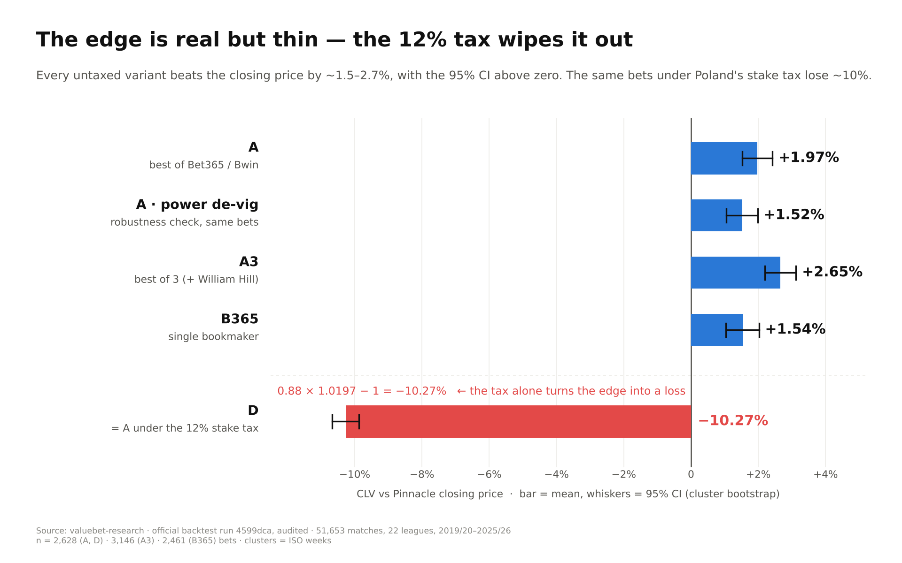
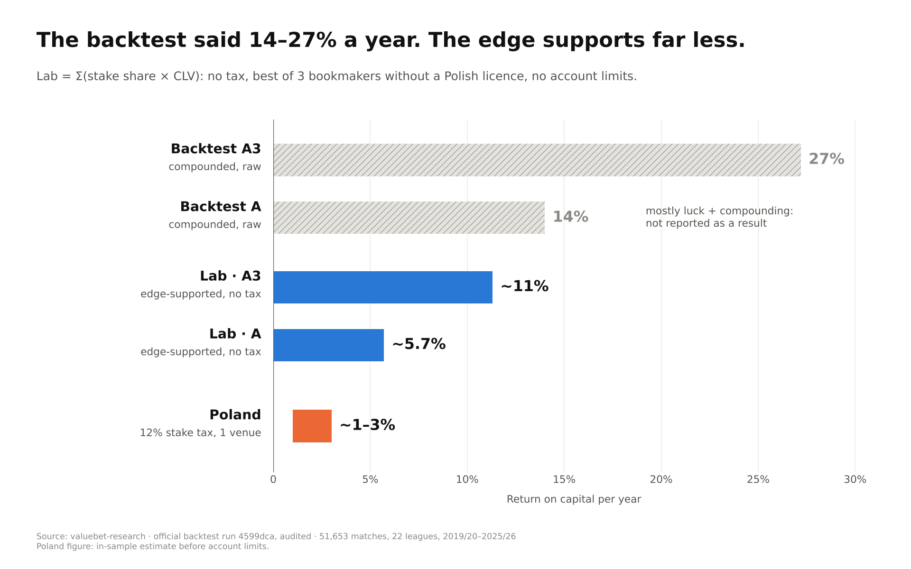
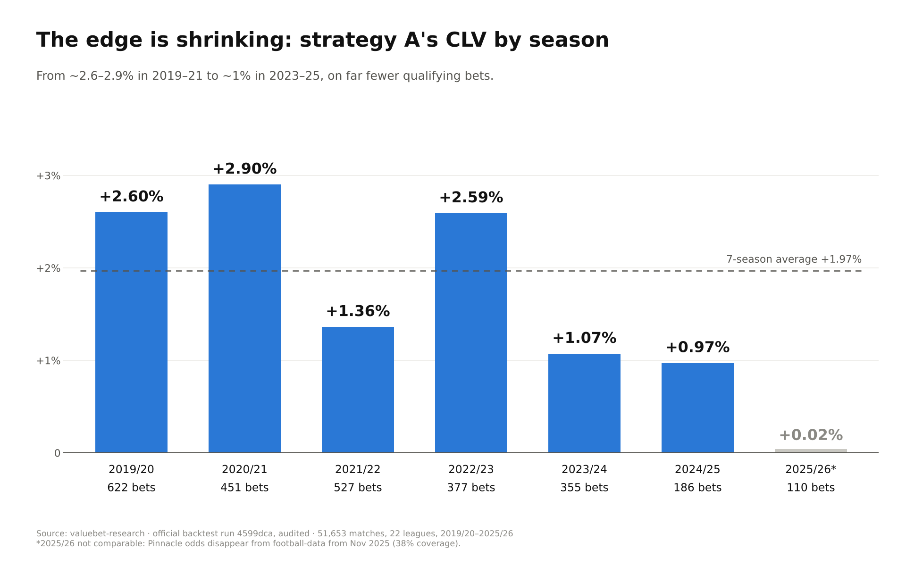

# Case study: is there a legal value-betting edge in Poland?

**Paweł Liszewski** · Management student, SGGW · Project: September–November 2026
Repository: [`valuebet-research`](https://github.com/Pawlacz1337/valuebet-research) · Licence: MIT

> **TL;DR.** I built a pre-registered research system to test one question: can a disciplined, strictly legal value-betting strategy make money at Polish licensed bookmakers? On 51,653 matches the system consistently bought prices **1.97% better than the closing market** (95% CI +1.52% to +2.42%). That edge is real, but Poland taxes every stake at 12%, which turns the same bets into a **−10.27%** loss. Only tax-free promotions leave an estimated **~1–3% of capital per year**. I stopped at the backtest stage on purpose: an honest "no" was the result the backtest was built to deliver if the numbers called for it.

---

## 1. The question and the constraints

Value betting means betting only when a bookmaker's price is higher than the "fair" price of the event. The fair price is estimated from a sharp market (Pinnacle) with the bookmaker's margin removed.

The project had four hard constraints:

- **Legal only.** Polish licensed bookmakers; no offshore sites (Art. 107 of the Polish Fiscal Penal Code).
- **Alert-only.** The system computes prices and sends alerts; it never places a bet.
- **Polish tax regime modelled exactly.** 12% of every stake, 10% on winnings above PLN 2,280, and tax-free promotions as a separate regime.
- **Decide before looking.** Strategies, metrics, alarm thresholds and verdict criteria were frozen in a plan before any result was computed.

## 2. Approach

| Component | What it does |
|---|---|
| Data | football-data.co.uk: 22 European leagues, 7 seasons (2019/20–2025/26), 51,653 matches. A 24/7 collector on a Linux VPS also recorded live odds via The Odds API (Oct–Nov 2026). |
| Fair price | Pinnacle odds with the margin removed by the **Shin method**. It calibrated best of the three methods tested (log-loss 0.99851 vs 0.99875 multiplicative). |
| Decision timing | **Point-in-time replay**: every decision sees only data available on Friday or Tuesday at 18:00 London, matching when the source collects odds. |
| Sizing | ¼ Kelly with caps of 2% per bet, 3% per match and 15% total exposure, plus a 25% drawdown circuit breaker. |
| Ledger | Integer grosze, append-only, reconciled by an independent double-entry check. |
| Primary metric | **CLV** (closing line value): how much better my price was than the fair closing price. 95% CI from a cluster bootstrap with ISO weeks as clusters. |

**Why CLV and not profit?** With ~2,600 bets, profit is mostly noise. Strategy A's yield was +7.24%, but its 95% CI ran from +0.92% to +13.61%, a 12.7 pp range. CLV measures the edge on *every* bet regardless of who won, so its CI is only 0.9 pp wide.

## 3. How I kept myself honest

- **Pre-registration.** No parameter was tuned after results were seen.
- **Engine gate (25 tests).** Known-answer, placebo and tax tests, plus "poison" tests: shuffling match results or closing odds must not change a single decision. If it did, the engine would be peeking at the future.
- **Seven adversarial audit rounds** (separate review sessions, see the last section). Earlier rounds caught two critical bugs that had passed every unit test. One was a tax window that looked into the future and was worth 6 pp of stake. The final full-system audit found **0 critical and 0 major issues** and recomputed strategies A, C and D independently, to the grosz.
- **Reproducibility.** Raw data is immutable and checked against a sha256 manifest. Every run is labelled with its commit hash. The repository has 1,083 automated tests, and `mypy --strict` passes.

## 4. Results: the edge is real but thin

| Strategy | What it is | Bets | CLV (95% CI) |
|---|---|---|---|
| A | best price of Bet365 / Bwin, tax-free | 2,628 | **+1.97%** (+1.52, +2.42) |
| A, robustness | same bets, power-method margin removal | 2,628 | +1.52% (+1.05, +1.98) |
| A3 | best of 3 (+ William Hill) | 3,146 | +2.65% (+2.19, +3.12) |
| B365 | single bookmaker | 2,461 | +1.54% (+1.04, +2.02) |
| D | A settled under the 12% stake tax | 2,628 | **−10.27%** |

The tax result is plain arithmetic: 0.88 × 1.0197 − 1 = −10.27%, which is exactly the measured CLV of D. No realistic edge in football markets survives a 12% charge on turnover.

## 5. The illusion I chose not to report

The raw backtest compounded to **+14% a year for A and +27% a year for A3**. Those are the numbers that end up in screenshots on social media. I treated them as a warning, for three reasons:

1. **Luck concentration.** The 10 biggest wins produced 56% of A's profit. Without them the yield falls to +3.2%.
2. **Model optimism.** The model's expected value overstated the realised CLV about 2.3×. Kelly stakes sized on the model's EV were therefore too large.
3. **Compounding magnifies noise.** A lucky streak early on grows every later stake.

The edge-supported return is the sum of (stake share × CLV) per year. It comes to ~5.7% a year for A and ~11% for A3. Even that is a **laboratory** figure: no tax, the best of three bookmakers without a Polish licence, and no account limits.

## 6. The edge is shrinking

CLV fell from +2.6–2.9% in 2019–2021 to about +1% in 2023–2025, and each season had fewer qualifying bets. The 2025/26 figure (+0.02%) is distorted because Pinnacle odds disappear from the dataset from November 2025. I report it but do not lean on it.

## 7. From the laboratory to Poland

| | Laboratory | Poland (estimate) |
|---|---|---|
| Bookmakers | best of 3, no Polish licence | 1 tax-free venue |
| Tax | none | 12% of every stake (tax-free only via promotions) |
| Expected return | ~11% of capital / yr (A3; ~7.6% on leagues available live) | **~1–3% of capital / yr** |

The Polish figure assumes a 1–2% worse price, because the measured margin at a Polish bookmaker was 7.3% versus about 4% for the best of three. It is in-sample and comes before any account limits, so it is an upper bound rather than a forecast.

## 8. Decision

At an expected 1–3% a year, with real risks of account limits and data drift, the system does not justify live money. I closed the project as a research result. The live collector ran 24/7 from 10 October to early November 2026 and was retired when the VPS trial ended.

## 9. What this project taught me

- **Hypothesis testing under noise.** Pick the metric with signal (CLV), not the one that looks good (profit).
- **Distrust of data.** Bookmakers silently disappear from datasets (Bwin missing ~37% of 2024/25, Pinnacle gone from late 2025). Every gap is documented, and none is filled with guesses.
- **Regulation as a model input.** The tax regime, not the model, decided the outcome.
- **Adversarial review.** Bugs that pass unit tests get caught by an auditor who is trying to break the result.

## 10. Limitations

- In-sample backtest; no live money was placed, so execution, limits and price drift are estimated, not observed.
- Historical prices for Polish bookmakers are not available; Bet365, Bwin and William Hill act as proxies.
- Shin's method still slightly overestimates longshots (p < 0.10: predicted 7.03% vs observed 5.97%), which flatters CLV on long odds.

## How this was built

I designed the research: the question, the legal and tax constraints, the methodology and the decision criteria. I worked through the design with an AI assistant (Claude) as a sparring partner and reviewer, and I made every go/no-go call, including the decision to stop. Claude Code wrote the code from task specifications I approved. The audit rounds ran in separate AI sessions instructed to break the result, and each finding was fixed with a regression test before the next step.
